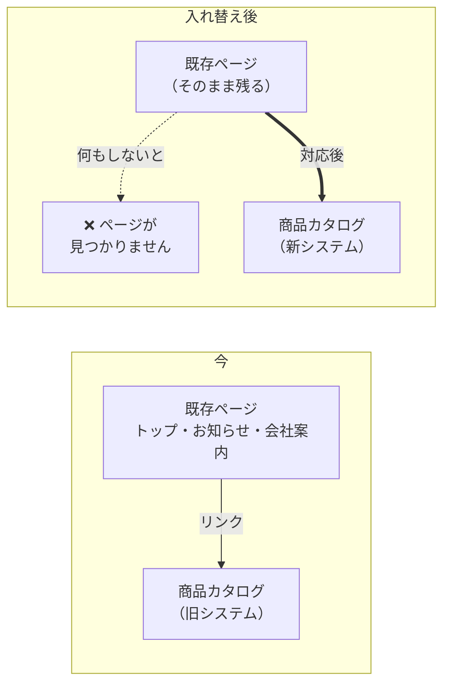
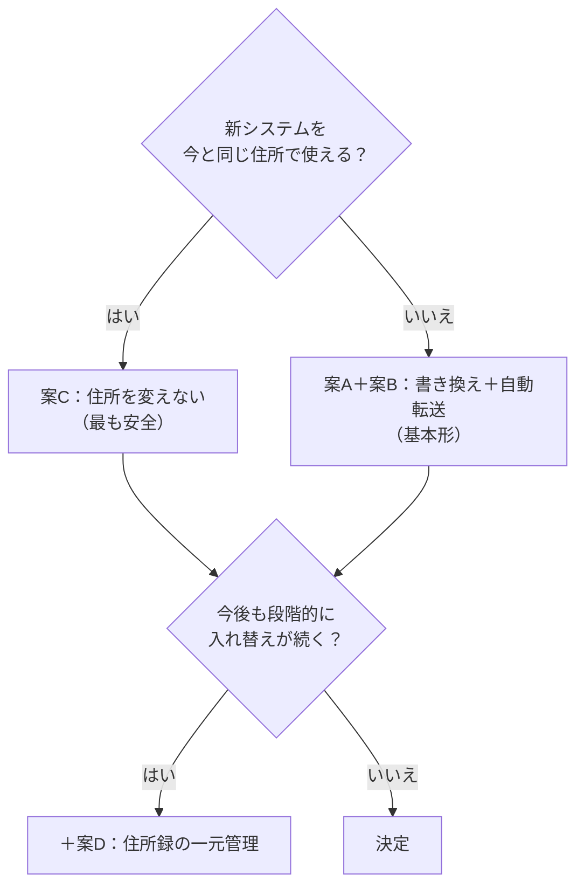

# Webサイト一部リプレイス リンク切替の対応案（誰でもわかる版）

Webサイトの一部を新しいシステムに入れ替えるとき、**今あるページのリンクをどうやって新システムにつなぐか**。その対応案を、専門用語をできるだけ使わずにまとめた資料です。

- 対象：企画・広報・営業・管理職など、システムに詳しくない方
- 技術的な詳細：[システム担当者向け版](02-for-engineers.md)
- 作成時点：2026年11月

---

## 1. 30秒でわかる結論

| | ポイント |
| --- | --- |
| **何が起きる？** | サイトの一部を入れ替えると、そのページの**住所（URL）が変わる**。今のページに貼ってあるリンクは**古い住所のまま**残る |
| **放っておくと？** | お客様がリンクを押すと **「ページが見つかりません」** と表示される |
| **どうする？** | **「リンクを書き換える」＋「古い住所に来た人を自動で新しい住所へ案内する」の2段構え**がおすすめ |
| **もっと良い方法は？** | 新システムを**今と同じ住所のまま**使えるなら、リンクの書き換えが不要になり最も安全 |

---

## 2. 何が起きるのか

たとえば、会社のWebサイトのうち **「商品カタログ」だけを新しいシステムに入れ替える** 場合を考えます。

- トップページ・お知らせ・会社案内などは**今のまま残る**（これを「静的コンテンツ」と呼びます。作ったまま置いてあるページのことです）
- それらのページには「商品一覧はこちら」のような**商品カタログへのリンク**がたくさん貼られている
- 新システムに入れ替わると、商品カタログの**住所が変わる**ため、リンクの行き先がなくなる

### リンクは「サイトの外」にもある

見落としがちですが、古い住所はサイトの外にもたくさん残っています。

| 場所 | 例 | サイト内の書き換えで直せる？ |
| --- | --- | :---: |
| サイト内のページ | トップのバナー、お知らせ記事の本文、メニュー | ✅ 直せる |
| PDF・資料 | パンフレットPDFの中のリンク | △ 作り直しが必要 |
| 印刷物 | チラシ・カタログ・名刺のQRコード | ❌ 直せない |
| メール | 過去に送ったメルマガ | ❌ 直せない |
| 社外 | 取引先のサイト、SNSの投稿、ネット広告 | ❌ 直せない |
| お客様の手元 | ブックマーク（お気に入り）、検索エンジンの検索結果 | ❌ 直せない |

> 💡 **ここが一番大事なポイントです。**
> サイト内のリンクを全部直しても、**サイトの外から古い住所に来るお客様は救えません**。だから「自動で案内する仕組み」が必要になります。

---

## 3. 4つの対応案（引っ越しにたとえると）

| 案 | 引っ越しでいうと | 実際にやること |
| --- | --- | --- |
| **A. リンクを書き換える** | 名刺やホームページに載せた住所を、新しい住所に書き直す | 既存ページのリンクを、新システムの住所に書き換える |
| **B. 自動で転送する** | 郵便局に**転送届**を出す | 古い住所に来た人を、新しい住所へ自動で案内する（専門用語で「リダイレクト」） |
| **C. 住所を変えない** | **同じ住所のまま**建て替える | 外から見た住所は変えず、裏側だけ新システムにつなぐ |
| **D. 住所録を1冊にまとめる** | 住所録を1か所に集め、次の引っ越しではそこだけ直す | リンク先を1か所で管理し、将来の変更を楽にする |

---

## 4. 4つの案を比べる

◎ とても良い　○ 良い　△ 注意が必要　✕ 対応できない

| 観点 | A. 書き換え | B. 自動転送 | C. 住所を変えない | D. 一元管理 |
| --- | :---: | :---: | :---: | :---: |
| サイト内でお客様が迷わない | ◎ | ○ （一瞬の転送が入る） | ◎ | ◎ |
| ブックマーク・QR・社外リンクを救える | ✕ | ◎ | ◎ | ✕ （Bと組み合わせる前提） |
| 検索順位への影響 | △ （単独だと下がりやすい） | ○ （評価を引き継げる） | ◎ （影響なし） | － |
| 費用・期間 | 中 （ページ数に比例） | 小〜中 | 中〜大 （新システム側の対応が必要） | 中 （最初だけ） |
| 切り替え後の手間 | なし | 転送ルールの管理が続く （最低1年） | 設定の管理 | 少ない |
| 実現できる条件 | ページを編集できる | サーバーの設定を変えられる | 新システムが同じ住所で動ける | 共通部品にする改修ができる |

---

## 5. おすすめ

**基本は「案A＋案B」の組み合わせ** です。片方だけでは穴があります。

| 片方だけだと… | 何が困る？ |
| --- | --- |
| 書き換え（A）だけ | ブックマーク・QRコード・検索結果・社外サイトから来たお客様が全員「見つかりません」になる |
| 自動転送（B）だけ | サイト内のリンクが毎回「回り道」になり表示が少し遅れる。転送ルールを永久に外せなくなる |

> **サイト内は書き換えでまっすぐつなぎ、サイトの外から来る人は転送で拾う。** これが最も確実です。

---

## 6. 進め方（スケジュールのイメージ）

規模によって変わります。目安としてご覧ください。

| ステップ | やること | 目安 |
| --- | --- | --- |
| ① 洗い出し | どのページにリンクがあるか、外からどれくらいお客様が来ているかを調べる | 2〜3週間 |
| ② 対応表づくり | 「古い住所 → 新しい住所」の一覧を作り、業務部門が内容を確認する | 2〜4週間 |
| ③ 準備・テスト | 書き換えと転送の設定を作り、テスト環境で**全件**確認する | 2〜4週間 |
| ④ 切り替え | 新システムの公開と同時に切り替える。当日は確認チームが待機 | 1日 |
| ⑤ 見守り | 「見つかりません」の発生を監視し、漏れがあれば追加する | 1〜3か月 |
| ⑥ 片付け | 転送がほとんど使われなくなったら整理する | **最低1年後** |

> ⚠️ **切り替えの前後は、既存ページの更新を一時停止**していただく必要があります（書き換え作業中に更新されると、直したリンクが元に戻ったり漏れが出たりするため）。

---

## 7. 業務部門に決めていただきたいこと

| # | 決めること | なぜ必要か |
| --- | --- | --- |
| 1 | 入れ替える範囲（どのページ・どの機能か） | 対応表を作る範囲が決まる |
| 2 | **なくなるページの扱い**（似たページへ案内する／「終了しました」と表示する） | 新システムに同じページがないケースがある |
| 3 | 切り替え日と、その前後の**ページ更新停止期間** | 書き換え中の更新は漏れの原因になる |
| 4 | 印刷物・QRコード・ネット広告の扱い | 刷り直しや広告の差し替えには時間がかかる |
| 5 | 取引先・提携先へのお知らせ | 社外サイトのリンクは先方にしか直せない |
| 6 | お客様へのお知らせ（必要な場合） | ブックマーク変更のお願い、問い合わせ窓口への周知 |
| 7 | 転送をいつまで続けるか | 最低1年を推奨。印刷物が長く出回るならそれ以上 |

---

## 8. よくある質問

**Q. 自動転送（B）だけで十分では？**
A. 動きはします。ただしサイト内のリンクが毎回「回り道」になり、転送ルールを永久に外せなくなります。サイト内は書き換え（A）でまっすぐつなぐのが基本です。

**Q. 書き換え（A）だけで十分では？**
A. ブックマーク・QRコード・検索結果・社外サイトから来たお客様が「見つかりません」になります。転送（B）は必須です。

**Q. 検索順位は下がりますか？**
A. 正しい種類の転送（「恒久的に引っ越しました」という合図＝**301**）を設定すれば、評価は新しいページに引き継がれます。切り替え直後に一時的な変動はありえます。

**Q. 切り替えに失敗したら元に戻せますか？**
A. 戻せるように準備します。転送の設定は短時間で元に戻せるため、**切り替えは「設定の切り替え」で行い、旧システムはしばらく停止せずに残しておく**のが安全です。

**Q. 転送はいつまで残せばよいですか？**
A. Googleは「最低1年」を推奨しています。QRコード付きの印刷物が出回っている場合は、その配布期間も考えて決めます。

---

## 9. ミニ用語集

| 用語 | 意味 |
| --- | --- |
| URL | ページの住所（例：`https://www.example.com/products/`） |
| リンク | 住所への案内板。押すとそのページへ移動する |
| 静的コンテンツ | 作ったまま置いてあるページ（会社案内・お知らせなど） |
| リプレイス | システムを新しいものに入れ替えること |
| リダイレクト | 古い住所に来た人を新しい住所へ自動で転送すること |
| 301 | 「恒久的に引っ越しました」という転送の合図。検索エンジンの評価も引き継がれる |
| 404 | 「ページが見つかりません」という表示 |

👉 技術的な実現方法・設定例・テスト方法は [システム担当者向け版](02-for-engineers.md) を参照してください。
