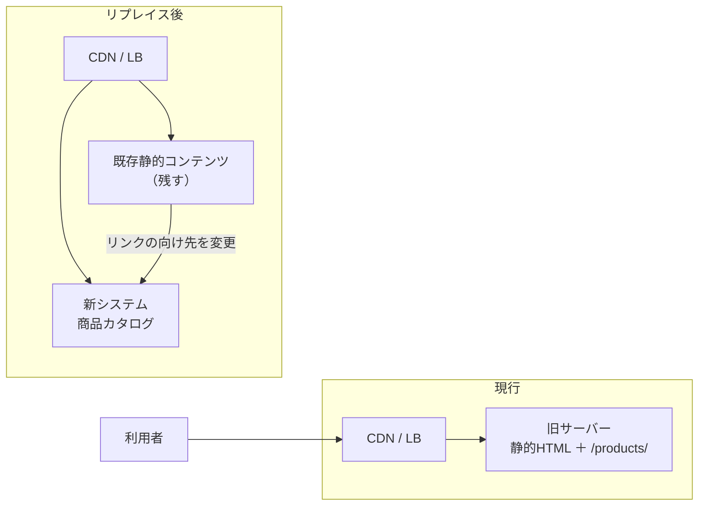
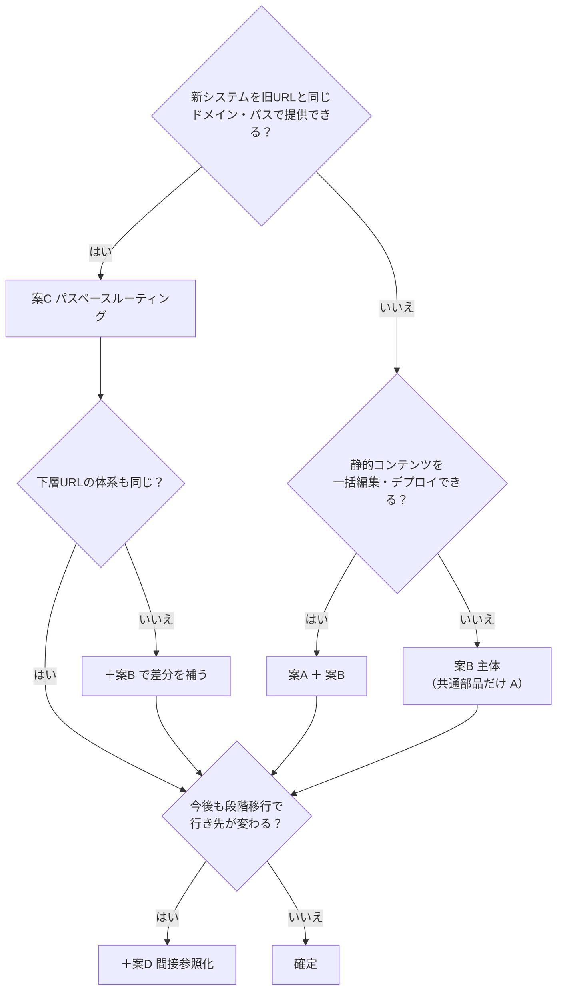
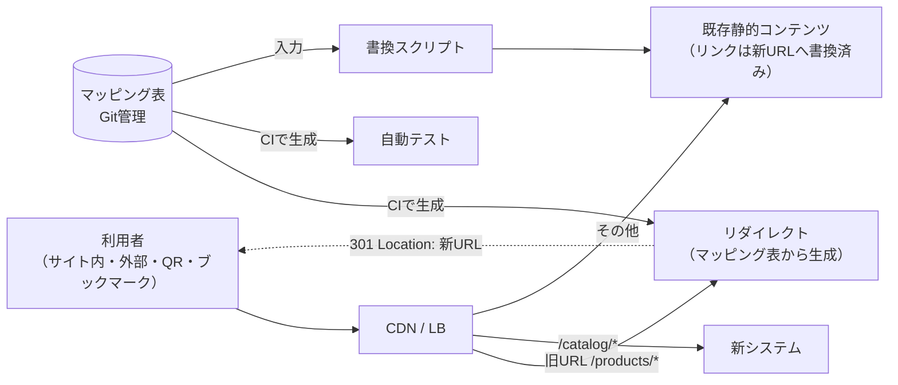
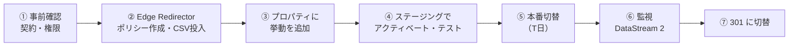

# Webサイト一部リプレイス リンク切替の対応案（システム担当者向け）

Webサイトの一部機能を新システムへリプレイスする際に、**既存の静的コンテンツから張られているリンク（遷移先）を新システムへ向ける** ための方式設計・実装・テスト・切替・運用をまとめた資料です。

- 対象：インフラ／アプリ／Web担当、PM
- 非技術者向けの説明：[誰でもわかる版](01-for-everyone.md)
- 作成時点：2026年11月

> ⚠️ 設定例は代表的な構成での書き方です。ミドルウェア・CDN の仕様や上限値はバージョン・契約で変わるため、適用前に各製品のドキュメントで確認してください。

---

## 目次

1. [結論（サマリ）](#1-結論サマリ)
2. [前提とスコープ](#2-前提とスコープ)
3. [リンクの棚卸し](#3-リンクの棚卸し)
4. [URLマッピング設計](#4-urlマッピング設計)
5. [対応案の詳細（A〜D）](#5-対応案の詳細ad)
6. [比較と選定フロー](#6-比較と選定フロー)
7. [推奨構成](#7-推奨構成)
8. [Akamai での実装手順](#8-akamai-での実装手順)
9. [落とし穴チェックリスト](#9-落とし穴チェックリスト)
10. [テスト](#10-テスト)
11. [切替手順とロールバック](#11-切替手順とロールバック)
12. [運用・撤去](#12-運用撤去)
13. [確認・決定事項](#13-確認決定事項)

---

## 1. 結論（サマリ）

| # | 方針 |
| --- | --- |
| 1 | **基本は 案A（内部リンクの一括書き換え）＋ 案B（旧URL→新URLのリダイレクト）** の併用。A をどこまでやるかは件数ではなく **一括置換できるか** で決める（[6.3](#63-規模と編集方法による判断a案をどこまでやるか)） |
| 2 | 新システムを旧URLと同じパスで提供できるなら **案C（パスベースルーティング）** が最良。リンク改修ゼロ |
| 3 | 段階移行で今後も行き先が変わるなら **案D（リンクの間接参照化）** を追加 |
| 4 | リダイレクトは **CDN／LB などエッジに置く**。廃止予定の旧システム上に置かない。Akamai の場合は **Edge Redirector Cloudlet**（[§8](#8-akamai-での実装手順)） |
| 5 | 切替は「設定の有効化」で行い、**直後は 302（または短いキャッシュの 301）→ 安定後に 301**。ロールバック＝設定を戻すだけにする |
| 6 | 工数の大半は実装ではなく **リンク棚卸しと URL マッピング表の作成・合意**。マッピング表を唯一の正（Single Source of Truth）として設定・テストを自動生成する |

---

## 2. 前提とスコープ

### 2.1 想定構成

- 既存サイト：`https://www.example.com`（静的 HTML。Web サーバー、または CDN＋オブジェクトストレージで配信）
- リプレイス対象：一部機能（例：`/products/` 配下の商品カタログ）を新システム（新CMS／SaaS／新規アプリ）へ移行
- 既存の静的コンテンツ（トップ・お知らせ・会社案内など）は**残す**



### 2.2 新システムの URL パターンと適用できる案

新システムの URL がどうなるかで、取れる案が決まります。**最初に確定させるべき事項**です。

| パターン | 例 | A 書換 | B 転送 | C ルーティング | D 間接参照 |
| --- | --- | :---: | :---: | :---: | :---: |
| ① 同一ドメイン・同一パス | `www.example.com/products/...` | 不要 | 部分的<br/>（下層URLが変わる分） | ◎ | 任意 |
| ② 同一ドメイン・別パス | `www.example.com/catalog/...` | ◎ | ◎ | △<br/>（パスの書換が必要） | ○ |
| ③ 別ドメイン（サブドメイン／SaaS） | `shop.example.com/...` | ◎ | ◎ | △<br/>（リバースプロキシで同一ドメイン化） | ○ |

---

## 3. リンクの棚卸し

### 3.1 リンクの所在と対応方法

| # | 所在 | 例 | 発見方法 | 対応 |
| --- | --- | --- | --- | --- |
| 1 | 静的 HTML の `<a href>` | 本文・バナー | ソース grep、クローラ | A |
| 2 | 共通部品（ヘッダー／フッター／SSI／テンプレート） | グローバルナビ | ソース grep | A（1か所の修正で全ページ反映） |
| 3 | JavaScript／JSON 内の URL | メニュー定義、スライダー設定 | grep（**文字列連結で組み立てている箇所に注意**） | A |
| 4 | フォームの `action` | 検索・問い合わせの送信先 | grep `action=` | A（B で受けるなら 307/308） |
| 5 | CSS `url()`、画像マップ `<area>`、`srcset` | | grep | A |
| 6 | SEO 系 | `sitemap.xml`・`canonical`・`hreflang`・OGP・構造化データ | grep | A |
| 7 | PDF／Office 文書内リンク | パンフレット PDF | `pdftotext` 等で抽出 | B（再作成は高コスト） |
| 8 | メール | 配信テンプレート、過去のメルマガ | 配信システム確認 | テンプレート＝A、過去分＝B |
| 9 | ネイティブアプリ内の固定 URL | WebView、ディープリンク | アプリソース | B（アプリ更新できれば＋A） |
| 10 | 印刷物の QR、広告 LP、アフィリエイト | | 部門ヒアリング | B（広告は入稿 URL も変更） |
| 11 | 外部サイト・SNS・ブックマーク・検索インデックス | | アクセスログの Referer、Search Console | B |
| 12 | 社内システム・FAQ・チャットボット | | ヒアリング | A または B |

> **#7〜#11 は自社で書き換えられない** → 案B（リダイレクト）が必須になる根拠です。

### 3.2 棚卸しの手順

**① ソースを grep（参照元の特定）**

```bash
# 旧パスを参照している箇所を洗い出す（絶対URL・ルート相対・相対の代表パターン）
grep -rnE 'example\.com/products/|="/products/|="(\.\./)+products/' htdocs/ > ref-in-source.txt
```

相対リンク（`products/` や `../products/`）は**ページの位置によって解決先が変わる**ため、grep だけでは漏れます。②のクローラで「解決後の URL」を取得して突き合わせます。

**② クローラで全リンクを抽出（解決後 URL の特定）**

```bash
# ステージングを再帰クロールし、全リンクと参照元ページを CSV で出力
linkchecker -o csv https://stg.example.com/ > all-links.csv
```

**③ アクセスログで「実際に使われている旧URL」と「外部の流入元」を把握**

```bash
# 旧パスへのアクセスを URL 別に集計（combined 形式。直近90日分などを対象に）
zcat access.log*.gz | awk '$7 ~ /^\/products\// {print $7}' | sort | uniq -c | sort -rn > old-url-hits.txt

# 外部サイトからの流入元（Referer）を集計 → 取引先・SNS・QR（Referer なし）の把握に使う
zcat access.log*.gz | awk -F'"' '$2 ~ /^GET \/products\// && $4 !~ /example\.com/ {print $4}' \
  | sort | uniq -c | sort -rn | head -50
```

> CDN 経由で配信している場合、**キャッシュヒットはオリジンに届かない**ため、オリジンのログだけでは件数が少なく出ます。CDN のログ（Akamai なら DataStream 2。[§8.7](#87-ログ監視datastream-2)）で集計してください。

**④ Search Console**：「リンク」レポートで外部から被リンクの多いページ、「ページ」レポートでインデックス済み URL を取得。

**⑤ 部門ヒアリング**：印刷物・広告・メール・アプリ・取引先の掲載 URL を収集。

### 3.3 アウトプット：リンク棚卸し表

| 参照元 | 旧リンク（記述のまま） | 解決後の旧URL | 種別 | 対応案 | 担当部門 |
| --- | --- | --- | --- | --- | --- |
| `/index.html` | `products/` | `/products/` | HTML | A | Web担当 |
| `/news/2025/0401.html` | `/products/item.html?id=123` | 同左 | HTML | A | 広報 |
| `pamphlet_2024.pdf` | `https://www.example.com/products/` | 同左 | PDF | B | 営業企画 |
| 取引先サイト | `https://www.example.com/products/a.html` | 同左 | 外部 | B＋先方連絡 | 営業 |

---

## 4. URLマッピング設計

### 4.1 マッピング表（唯一の正）

マッピング表を Git で管理し、**サーバー設定・書き換えスクリプト・テストをすべてここから生成**します。

```csv
old_path,new_url,type,status,owner,note
/products/,https://www.example.com/catalog/,1:1,301,EC部,一覧トップ
/products/a.html,https://www.example.com/catalog/items/a,1:1,301,EC部,
/products/category/*,https://www.example.com/catalog/c/$1,pattern,301,EC部,カテゴリは規則変換
/products/campaign2019/,https://www.example.com/catalog/,N:1,301,販促,終了キャンペーン→一覧へ
/products/old-faq.html,,gone,410,CS,FAQは廃止
```

### 4.2 マッピングの型

| 型 | 説明 | 実装 | 注意 |
| --- | --- | --- | --- |
| 1:1 | 個別に対応 | マップ／KVS 参照 | 件数が多ければ正規表現を並べずマップで引く |
| pattern | 規則的に変換（`/products/category/(.+)` → `/catalog/c/$1`） | 正規表現 | 例外 URL を先に評価する |
| N:1 | 統合・廃止で代替先へ集約 | マップ | **何でもトップへ飛ばさない**（検索エンジンにソフト404と見なされうる）。内容の近いページへ |
| gone | 代替なしで廃止 | 410（または 404＋案内） | 業務部門の承認を取る |
| keep | 同じ URL で新システムが応答 | 案C | 下層 URL の差分だけ B で補う |

### 4.3 事前に決める正規化ルール

| 項目 | 決めること |
| --- | --- |
| 末尾スラッシュ | `/products` と `/products/` を同一視するか |
| `index.html` | `/products/index.html` を `/products/` と同一視するか |
| 大文字小文字 | 旧サーバーが IIS（大小無視）なら、`/Products/` 等の表記揺れが外部リンクに残っている可能性 |
| クエリ | **引き継ぐ**（`utm_*` 等の計測）／**変換する**（`?id=123` → `/items/123`）／**捨てる**（セッションID）を決める |
| エンコード | 日本語 URL はエンコード済み／デコード済みのどちらで照合するか（サーバーにより異なる） |
| スキーム・ホスト | 既存の `http→https`・`www` 付与リダイレクトと**1ホップにまとめる**（チェーン防止） |
| フラグメント（`#`） | **サーバーには届かない**。ブラウザは転送先に `#` を引き継ぐので、新ページで同じアンカーIDを用意するか JS で変換 |

---

## 5. 対応案の詳細（A〜D）

### 案A：静的コンテンツ内リンクの一括書き換え

**仕組み**：マッピング表を入力に、静的 HTML 内の旧 URL を新 URL へ置換して再デプロイ。

**手順**：①ドライランで置換一覧を出力 → ②担当部門がレビュー → ③適用して diff レビュー → ④デプロイ＋CDN キャッシュパージ

**スクリプト例**（相対・絶対・プロトコル相対リンクを解決してから照合。`#` アンカーは引き継ぐ）：

```python
#!/usr/bin/env python3
"""マッピング表（CSV）に従い、静的HTML内のリンクを新URLへ書き換える。
使い方: python3 rewrite_links.py mapping.csv htdocs/          # ドライラン（変更内容の表示のみ）
        python3 rewrite_links.py mapping.csv htdocs/ --apply  # 実際に書き換え
"""
import csv
import re
import sys
from pathlib import Path
from urllib.parse import urljoin, urlsplit

SITE = "https://www.example.com"            # 既存サイトのURL
OWN_HOSTS = {"www.example.com", "example.com"}
TARGET_PREFIX = "/products/"                 # リプレイス対象のパス
ENCODING = "utf-8"                           # 旧サイトが Shift_JIS なら "cp932"
ATTR = re.compile(r'(?P<attr>\b(?:href|action|src)\s*=\s*)(?P<q>["\'])(?P<url>[^"\']*)(?P=q)', re.I)


def load_map(path):
    with open(path, encoding="utf-8") as f:
        return {r["old_path"]: r["new_url"] for r in csv.DictReader(f)}


def to_key(page_url, url):
    """相対/絶対/プロトコル相対のリンクを絶対URLに解決し、自サイト内なら「パス+クエリ」を返す"""
    u = urlsplit(urljoin(page_url, url))
    if u.netloc not in OWN_HOSTS:
        return None, ""
    path = u.path[:-len("index.html")] if u.path.endswith("/index.html") else u.path
    return path + (f"?{u.query}" if u.query else ""), u.fragment


def main(map_csv, root, apply=False):
    mapping, root = load_map(map_csv), Path(root)
    for file in sorted(root.rglob("*.htm*")):
        page_url = f"{SITE}/{file.relative_to(root).as_posix()}"
        text = file.read_text(encoding=ENCODING)

        def repl(m):
            key, frag = to_key(page_url, m["url"])
            if key is None or not key.startswith(TARGET_PREFIX):
                return m[0]                               # 対象外のリンクはそのまま
            new = mapping.get(key)
            if new is None:
                print(f"[未登録] {file}: {m['url']}  ← 対応表に追加が必要", file=sys.stderr)
                return m[0]
            if new == "":
                print(f"[廃止先] {file}: {m['url']}  ← リンク自体の削除/差替えを手作業で", file=sys.stderr)
                return m[0]
            new += f"#{frag}" if frag else ""             # ページ内アンカー(#)は引き継ぐ
            print(f"[置換] {file}: {m['url']} -> {new}")
            return f'{m["attr"]}{m["q"]}{new}{m["q"]}'

        new_text = ATTR.sub(repl, text)
        if apply and new_text != text:
            file.write_text(new_text, encoding=ENCODING)


if __name__ == "__main__":
    main(sys.argv[1], sys.argv[2], apply="--apply" in sys.argv)
```

- `pattern` 型の行は、事前に実在 URL へ展開してから渡すか、スクリプトに正規表現照合を追加する
- JS で文字列連結している URL、引用符なし属性、`srcset` はこのスクリプトでは拾えない → `[未登録]` 出力と grep 結果を突き合わせて手修正
- CMS 管理のページは DB 側を置換（例：WordPress は `wp search-replace`。シリアライズデータも安全に置換できる）

| メリット | デメリット |
| --- | --- |
| 転送ホップがなく最速・SEO 上もクリーン | 外部リンク・ブックマーク・QR・PDF は救えない |
| 切替後の運用負荷なし | ページ数・編集主体（部門）の数に比例して工数増 |
| | 切替日まで書き換え済み HTML を出せない（同時デプロイが必要） |

### 案B：旧URLでリダイレクト

**仕組み**：旧 URL へのリクエストに 3xx ＋ `Location: 新URL` を返す。設置場所で4種類あります。

| 方式 | 設置場所 | 向く条件 | 注意 |
| --- | --- | --- | --- |
| **B-1 Webサーバー** | Apache／nginx／IIS | 既存の Web サーバーを当面使い続ける | 旧サーバー廃止時に一緒に消えない構成に |
| **B-2 エッジ（推奨）** | CDN／LB（CloudFront、Cloudflare、ALB 等） | 新旧どちらのシステムからも独立させたい | ルール数の上限（下記）を確認 |
| **B-3 転送用HTML** | 旧URLにスタブHTMLを配置 | サーバー設定を一切触れない（ホスティング制約） | 最終手段。ステータスは 200 になる |
| **B-4 新システム側** | 新システムが旧パスも受ける | 同一ドメインで新システムが旧パスを受けられる | 新システムに旧仕様の知識が残る |

#### HTTP ステータスの選び方

| コード | 意味 | 使いどころ | 注意 |
| --- | --- | --- | --- |
| **301** | 恒久的な移転 | 安定後の基本 | ブラウザが長期キャッシュする → 誤設定を後から取り消しにくい。`Cache-Control: max-age` で期限を付けると安全 |
| **302** | 一時的な移転 | 切替直後〜安定確認まで | 長期間使い続けない |
| **307 / 308** | 302 / 301 のメソッド保持版 | **フォームの POST 先** | 301/302 では POST が GET に変わることがある |
| **410** | 削除済み | 代替のない廃止ページ | 404 より「意図的な削除」が明確 |
| 404 | 存在しない | 想定外アクセス | カスタム404で検索・トップへ誘導 |

#### B-1：nginx

```nginx
# http コンテキスト
map_hash_bucket_size 256;          # 長いURLが多い場合に必要
map $uri $redirect_to {
    default "";
    include /etc/nginx/redirects.map;   # マッピング表から生成。1行1件: /products/a.html https://www.example.com/catalog/items/a;
    ~^/products/category/(?<cat>[a-z0-9-]+)/?$  https://www.example.com/catalog/c/$cat;
}

server {
    server_name www.example.com;

    # クエリ（utm_* 等）を引き継いで転送
    if ($redirect_to) {
        return 301 $redirect_to$is_args$args;
    }

    # クエリで商品を指定していた旧URL → 新URLのパスへ変換
    location = /products/item.html {
        if ($arg_id ~ "^\d+$") {
            return 301 https://www.example.com/catalog/items/$arg_id;
        }
        return 301 https://www.example.com/catalog/;
    }
}
```

#### B-1：Apache（`RewriteMap` は .htaccess では使えないため vhost に記述）

```apache
RewriteEngine On

# 1:1 はマップで引く（大量なら httxt2dbm で dbm 化）。1行1件: /products/a.html https://www.example.com/catalog/items/a
RewriteMap redirects "txt:/etc/httpd/conf/redirects.txt"
RewriteCond ${redirects:%{REQUEST_URI}} ^(.+)$
RewriteRule ^ %1 [R=301,L,NE]

# パターン変換
RewriteRule ^/?products/category/([a-z0-9-]+)/?$ https://www.example.com/catalog/c/$1 [R=301,L]

# クエリで指定していた旧URL（末尾の ? で元のクエリを破棄）
RewriteCond %{QUERY_STRING} (?:^|&)id=(\d+)(?:&|$)
RewriteRule ^/?products/item\.html$ https://www.example.com/catalog/items/%1? [R=301,L]
```

#### B-2：CDN／LB

| サービス | 機能 | 向く使い方 |
| --- | --- | --- |
| Amazon CloudFront | CloudFront Functions ＋ KeyValueStore | 大量の 1:1 をキー参照で（下記例） |
| Cloudflare | Bulk Redirects ／ Single Redirects | 大量 1:1 は Bulk、パターンは Single |
| AWS ALB | リスナールールの redirect アクション | **少数のパターンのみ**（ルール数に上限あり） |
| Amazon S3 静的ウェブサイト | ルーティングルール | **50件まで**のため小規模のみ |
| **Akamai** | Edge Redirector Cloudlet ／ Redirect 挙動 ／ EdgeWorkers ＋ EdgeKV | 大量 1:1 は Edge Redirector。手順は [§8](#8-akamai-での実装手順) |

CloudFront Functions（JavaScript ランタイム 2.0、ビューワーリクエストに関連付け）：

```javascript
import cf from 'cloudfront';

// 関数に関連付けた KeyValueStore（キー=旧パス、値=新URL）
const kvs = cf.kvs('<KVS_ID>');

async function handler(event) {
  const req = event.request;
  let to;
  try {
    to = await kvs.get(req.uri);
  } catch (e) {
    return req;              // 対応表にない → そのままオリジンへ
  }
  // クエリ（utm_* 等）を引き継ぐ場合は req.querystring から組み立てて連結する
  return {
    statusCode: 301,
    statusDescription: 'Moved Permanently',
    headers: { location: { value: to } },
  };
}
```

#### B-3：転送用 HTML（サーバー設定を触れない場合の最終手段）

```html
<!doctype html>
<html lang="ja">
<head>
  <meta charset="utf-8">
  <title>このページは移転しました</title>
  <link rel="canonical" href="https://www.example.com/catalog/">
  <meta http-equiv="refresh" content="0; url=https://www.example.com/catalog/">
</head>
<body>
  <p>このページは移転しました。<a href="https://www.example.com/catalog/">新しいページへ移動する</a></p>
</body>
</html>
```

| メリット | デメリット |
| --- | --- |
| 外部リンク・ブックマーク・QR・PDF・検索インデックスまで救える | サイト内リンクにも毎回1ホップ（モバイルで体感される場合あり） |
| 静的コンテンツを触らずに済む | 転送ルールの管理が長期間続く（最低1年） |
| 切替・ロールバックが設定変更だけで済む | マッピング漏れは 404 になる（監視必須） |

### 案C：パスベースルーティング（URL 維持）

**仕組み**：CDN／LB／リバースプロキシで、旧 URL のパス（`/products/*`）を新システムへ振り分ける。**外から見た URL は変わらない**。

```nginx
location /products/ {
    proxy_pass https://new-catalog.internal/products/;
    proxy_ssl_server_name on;                     # HTTPS オリジンの SNI
    proxy_set_header Host $host;                  # 新システムが自ホスト名を要求する場合はそのホスト名に
    proxy_set_header X-Forwarded-Proto $scheme;
    proxy_set_header X-Forwarded-For $proxy_add_x_forwarded_for;
}
```

同等の構成：CloudFront の**ビヘイビア（パスパターン → 別オリジン）**、ALB の**パスベースルーティング（→ 別ターゲットグループ）**。

**成立条件（新システム側の確認が必須）**：

- [ ] 新システムが**ベースパス配下**（`/products/`）で動作できる（画像・CSS・JS のパス、アプリが生成するリンク・リダイレクト先）
- [ ] `X-Forwarded-*` を解釈し、自分の URL を正しく組み立てられる
- [ ] 同一ドメインで **Cookie 名・パスが既存と衝突しない**、セッション／SSO が成立する
- [ ] SaaS の場合、**リバースプロキシ配下での利用が仕様・規約上許可**されている
- [ ] キャッシュ方針を既存静的コンテンツと分けられる（動的ページをキャッシュしない）
- [ ] 下層 URL の体系が旧と異なる部分は B で補う

| メリット | デメリット |
| --- | --- |
| 外部リンク・SEO・ブックマークへの影響ゼロ。静的コンテンツは無改修 | 新システム側の改修・検証コストが大きい |
| 段階移行（ストラングラーフィグ）に最適：パス単位で順次切替・即時切り戻し | プロキシが障害点・性能ボトルネックになりうる |
| | SaaS では不可のことが多い |

### 案D：リンクの間接参照化（将来の変更に備える）

| 方式 | 内容 | 向く場面 |
| --- | --- | --- |
| D-1 共通部品化 | ヘッダー／フッター／ナビを SSI・テンプレート・ビルド時インクルードに集約 | 全ページ共通のリンク |
| D-2 中継URL | 静的コンテンツは常に `/go/catalog` へリンクし、行き先はリダイレクト表で管理 | 段階移行で行き先が何度も変わる |
| D-3 リンク定数 | URL を JSON 等の定数ファイルに集約し、ビルド時に埋め込む（SSG） | ビルド工程があるサイト |

- D-2 は常に1ホップ増えるため、**ナビゲーションなど限定箇所に使う**（本文リンクは A で直接書く）
- `/go?url=https://...` のような **任意 URL を受け取る転送は作らない**（オープンリダイレクト脆弱性）。キー指定のみとする

---

## 6. 比較と選定フロー

### 6.1 比較表

| 観点 | A 書換 | B 転送 | C ルーティング | D 間接参照 |
| --- | :---: | :---: | :---: | :---: |
| サイト内リンク | ◎ | ○（1ホップ） | ◎ | ○〜◎ |
| 外部リンク・ブックマーク・QR・PDF | ✕ | ◎ | ◎ | ✕ |
| SEO | △（単独では評価が切れる） | ○（301で引継ぎ） | ◎ | － |
| 実装工数 | 小〜大（一括置換なら件数にほぼ依存しない／手作業なら件数比例） | 小〜中 | 中〜大 | 中（初回のみ） |
| 新システム側の改修 | 不要 | 不要 | **必要** | 不要 |
| 運用負荷 | なし | 中（1年以上の維持） | 中（プロキシ運用） | 小 |
| ロールバック | △（再デプロイ） | ◎（設定戻し） | ◎（ルーティング戻し） | ◎ |
| 段階移行への適性 | △ | ○ | ◎ | ◎ |
| 主なリスク | 漏れ・同時デプロイ | マッピング漏れ、チェーン | 新システムの適合性 | オープンリダイレクト |

### 6.2 選定フロー



### 6.3 規模と編集方法による判断（A案をどこまでやるか）

**判断の軸はリンク件数ではなく「一括置換できるか」** です。

- マッピング表は案B でも必須 → 案A の追加コストは「置換・レビュー・デプロイ」だけ
- マッピング表の工数は **ユニークな旧URLの数** に比例し、リンク件数には比例しない（1000リンクでも旧URLは数十種類ということが多い）
- 一括置換できれば件数はほぼ無関係。手作業だと件数に比例する（1件数分 × 1000件 ＝ 数十時間＋修正ミスのリスク）

| リンク件数 | 一括置換できる（ファイル／Git、DB一括置換） | 手作業（CMSで部門ごとに編集） |
| --- | --- | --- |
| 〜100件 | A＋B | A＋B |
| 〜1,000件 | **A＋B**（スクリプトで数日） | **共通部品＋主要ページだけ A、残りは B** |
| 10,000件〜 | A＋B | **B 主体**＋通常更新のついでに段階的に A |

#### 案B 単独（リダイレクトのまま）を許容してよいケース

- 既存の静的コンテンツ自体が **1〜2年以内に作り直し・廃止** される予定
- 手作業でしか直せず、費用対効果が合わない
- 段階移行の途中で、**行き先がまたすぐ変わる**（この場合は案D も検討）

#### 案B 単独のデメリットと影響度

| 項目 | 影響 | 内容 |
| --- | :---: | --- |
| 表示速度 | 小 | 1ホップ分の往復が増える（目安 0.1 秒前後。モバイル回線で大きくなることがある） |
| SEO | 小 | 検索エンジンは転送を辿れる。ただし内部リンクは最終URLへ直接張るのが推奨 |
| **運用** | **大** | **転送設定を永久に撤去できない**。次回の移行時に「旧→中間→新」のチェーンが発生しやすい |

#### 手作業・大規模の場合の進め方（段階的 A）

1. **共通部品（ヘッダー／フッター／ナビ）を A で修正**：1か所の修正で全ページに反映され、件数の大半を占めることが多い
2. **転送の発生元の上位ページを A で修正**：自サイト内から転送されている遷移を参照元ページ別に集計し、上位から直す（2割のページでクリックの大半をカバーできることが多い）

   ```bash
   # 自サイト内から旧URLへ遷移し、転送(3xx)になっている参照元ページを集計（combined 形式のログ）
   zcat access.log*.gz \
     | awk -F'"' '$2 ~ /^GET \/products\// && $3 ~ /^ 30[1278] / && $4 ~ /example\.com/ {print $4}' \
     | sort | uniq -c | sort -rn | head -30
   ```

   CDN で転送している場合、転送はオリジンのログに残らないため CDN のログで集計する（Akamai は [§8.7](#87-ログ監視datastream-2)）

3. **残りは B で受け、ページ更新のついでに直す**：§12 の CI チェックを「失敗」ではなく「警告」にして、新規・更新ページから順に解消する

---

## 7. 推奨構成

**案A＋案B（リダイレクトはエッジに配置）** の構成：



- サイト内からの遷移：書き換え済みリンクで新システムへ**直接**
- サイト外からの遷移：エッジで新 URL へ**1ホップ**で転送
- マッピング表を Git 管理し、リダイレクト設定（nginx map／KVS 等）・テスト・書き換えをすべて生成

---

## 8. Akamai での実装手順

既存サイトを Akamai（Property Manager のプロパティ）経由で配信している場合の手順です。

> ⚠️ 使える機能は**契約モジュールによって異なります**。最初に Akamai Control Center（ACC）で契約内容と権限を確認してください。画面名・項目名は ACC の更新で変わることがあります。

### 8.1 使う機能の選び方

| やりたいこと | Akamai の機能 | 目安・注意 |
| --- | --- | --- |
| 旧URL→新URLの転送（案B）を大量に | **Edge Redirector Cloudlet** | 本命。CSV で一括登録できる。301／302／303／307／308 に対応 |
| 転送が数件〜数十件だけ | Property Manager の Redirect／Redirect Plus 挙動 | 件数が増えるとプロパティが肥大化するので少数のみ |
| 転送が数千〜数万件 | EdgeWorkers ＋ EdgeKV | 別契約・開発が必要。EdgeKV の読み込みレート上限を確認 |
| パス単位で新システムへ振り分け（案C） | Property Manager のルール（パス条件 ＋ Origin Server 挙動） | |
| 割合を決めて段階的に新システムへ（案C） | **Phased Release Cloudlet** | 例：10%→50%→100%。Cookie で同じ利用者は同じ行き先に固定 |
| 書き換え後 HTML のキャッシュ削除 | **Fast Purge**（invalidate 推奨） | 通常数秒で反映 |
| ログ（404 監視・参照元の集計） | **DataStream 2** | [§8.7](#87-ログ監視datastream-2) |

> ⚠️ **Edge Redirector のルール数**：1ポリシーあたり最大 5,000 ルールですが、リクエストごとの**処理コストに上限**があり、ルールの複雑さによっては **1,000 ルールを超えたあたりで上限に達する**ことがあります。リンクが 1,000 件でも旧 URL の種類が数百なら収まることが多いものの、**ステージングで必ずコストを測定**してください（[§8.5](#85-ステージングでのテスト)）。
> 収まらない場合：規則的なものはパターン（正規表現）1ルールにまとめる／パスごとにポリシーを分ける／EdgeWorkers ＋ EdgeKV を検討。

### 8.2 全体の流れ



- **プロパティと Cloudlet ポリシーは別々にバージョン管理・アクティベート**します（どちらもステージング → 本番の順）
- どちらも**前のバージョンを再アクティベートすればロールバック**できます

### 8.3 Edge Redirector ポリシーの作成とルール登録

1. ACC の **Cloudlets Policy Manager** で新規ポリシーを作成（タイプ：Edge Redirector）
2. ルールを登録（手入力または CSV アップロード）
   - CSV アップロード時、「Overwrite existing?（既存を上書き）」にチェックすると全置換、外すと末尾に追加
   - ルールは**上から順に評価され、最初に一致したものが適用**される → 個別ルールを上、パターンルールを下に
3. ポリシーのバージョンを**ステージングにアクティベート**

**各ルールの主な設定**：

| 項目 | 設定 |
| --- | --- |
| 一致条件 | 旧URL（**プロトコル・ホスト込み**の完全な URL）。パターンは正規表現などの詳細条件で |
| 転送先 | 新URL。https・正規ホストの**最終URL**を指定し、チェーンを作らない |
| ステータス | 切替直後は **302**、安定後に **301**（フォームの POST 先は 307／308） |
| クエリ | 元のクエリ文字列（`utm_*` 等）を引き継ぐオプションを有効にする |

**マッピング表から取り込み用 CSV を生成**（[§4.1](#41-マッピング表唯一の正) の表を唯一の正にする）：

```python
#!/usr/bin/env python3
"""マッピング表 → Edge Redirector 取り込み用CSV（1:1 と N:1 のみ。pattern・gone は別途）
使い方: python3 to_er_csv.py mapping.csv er-rules.csv 302   # 切替直後は302、安定後は301で再生成
※ 列名は ACC でポリシーからダウンロードした CSV の見出しに合わせること"""
import csv
import sys

SITE = "https://www.example.com"   # 一致条件はプロトコル・ホスト込みで指定する
src, dst, status = sys.argv[1], sys.argv[2], sys.argv[3]
with open(src, encoding="utf-8") as f, open(dst, "w", encoding="utf-8", newline="") as o:
    w = csv.writer(o)
    w.writerow(["ruleName", "matchURL", "result.redirectURL", "result.statusCode"])
    for i, r in enumerate(csv.DictReader(f), 1):
        if r["type"] in ("1:1", "N:1") and r["new_url"]:
            w.writerow([f"r{i:04d}", SITE + r["old_path"], r["new_url"], status])
```

- `pattern` 型：正規表現の詳細条件で手登録する（件数は少ないはず）
- `gone`（410）：Edge Redirector は転送専用 → オリジンで 410 を返すか、Property Manager の Construct Response 挙動で返す（選べるステータスコードは要確認）
- Terraform（Akamai Provider）で管理する場合は、マッピング表から `akamai_cloudlets_edge_redirector_match_rule` を生成して Git 管理できる

### 8.4 プロパティへの組み込み（Property Manager）

**案B（転送）**：

1. 現在の本番バージョンをもとに**新しいバージョンを作成**
2. ルールを追加：条件「Path が `/products/*` に一致」→ 挙動「**Edge Redirector Cloudlet**」（有効化し、§8.3 のポリシーを選択）
   - 条件で対象パスに絞ると、他のページで無駄な評価が走らず、誤った転送も防げる
3. 既存の `http→https`・`www` 付与のリダイレクトとの順序を確認し、**1ホップで最終URLに届く**ようにする
4. 新しいバージョンを**ステージングにアクティベート**

**案C（パスで新システムへ振り分け）の場合**は、さらに次を設定：

| 設定 | 内容 |
| --- | --- |
| ルール条件 | Path が新システムに渡すパス（例：`/products/*`）に一致 |
| Origin Server 挙動 | 新システムのホスト名。Forward Host Header（受信した Host を渡すか、新システムのホスト名を渡すか）と Cache Key Hostname を新システムの要件に合わせる |
| Caching 挙動 | 動的ページはキャッシュしない |
| Allow POST 挙動 | フォームを扱う場合は POST が許可されていることを確認 |
| Rewrite URL 挙動 | 新システム側のパスが異なる場合に、オリジンへ渡すパスを書き換える |
| 段階切替 | 新システムを **Conditional Origin（条件付きオリジン）** として定義し、**Phased Release Cloudlet** で割合を指定（例：10%→50%→100%） |

### 8.5 ステージングでのテスト

Akamai には本番と同じ設定を試せる**ステージングネットワーク**があります。エッジホスト名の末尾 `.net` の前に `-staging` を入れたホストに接続します（例：`www.example.com.edgekey.net` → `www.example.com.edgekey-staging.net`）。

```bash
STG=www.example.com.edgekey-staging.net

# 1件確認：URL は本番のまま、接続先だけステージングに向ける（hosts の書き換え不要）
curl -sI --connect-to www.example.com:443:$STG:443 \
  -H 'Pragma: akamai-x-cache-on, akamai-x-get-cache-key' \
  https://www.example.com/products/a.html
#  → X-Akamai-Staging ヘッダーがあればステージング経由。ステータスと Location を確認

# Edge Redirector の処理コストを確認（ステージングのみ。レスポンスヘッダーでコストを確認）
curl -sI --connect-to www.example.com:443:$STG:443 \
  -H 'X-Akamai-Cloudlet-Cost: True' \
  https://www.example.com/products/a.html

# 全件テスト：§10.1 のスクリプトをステージングに向けて実行
CURL_OPTS="--connect-to www.example.com:443:$STG:443" \
  ./check_redirects.sh mapping.csv https://www.example.com
```

- ACC の **Policy Analysis Tool**（Edge Redirector で利用可）でも、ルールごとのコストを確認できる
- ブラウザで確認する場合は、ステージングの IP アドレスを hosts に書く。IP は変わることがあるため、**テストのたびに名前解決し直す**

### 8.6 本番切替（T日の Akamai 作業）

| 時期 | 作業 |
| --- | --- |
| T-数日 | プロパティの新バージョン（Edge Redirector 挙動を含む）を**本番にアクティベート**。ポリシーは本番に未アクティベートのままにし、**既存の動作が変わらないこと**を確認する（ポリシー未アクティベートの間は転送されないことを、事前にステージングで確認しておく）。案C は Phased Release の割合 0% で反映しておく |
| **T日** | ①新システム公開・直接アクセスで確認 → ②Edge Redirector ポリシー（302版）を**本番にアクティベート**（案C は Phased Release の割合を上げる）→ ③書き換え済み HTML をオリジンへデプロイ → ④**Fast Purge** で書き換えたページを invalidate → ⑤本番で全件テスト（`CURL_OPTS` なしで §10.1 を実行） |
| T+2〜4週 | ポリシーの新バージョン（301版）を作成 → ステージング → 本番 |

> プロパティを事前に反映できない場合は、T日にプロパティとポリシーの両方をアクティベートします。**プロパティの本番反映は数分〜十数分程度かかる**ことがあるため、その前提で当日の工程を組んでください。

**Fast Purge（Akamai CLI の purge プラグイン。初回のみ `akamai install purge`）**：

```bash
# 書き換えで変更したファイル → URL 一覧（/about/index.html と /about/ は別キャッシュなので両方含める）
git diff --name-only <切替前のリリースタグ> -- htdocs/ \
  | sed 's#^htdocs/#https://www.example.com/#' \
  | sed -E 'p; s#/index\.html$#/#' | sort -u > changed-urls.txt

# まとめて invalidate（delete より invalidate を推奨。オプションは akamai purge --help で確認）
cat changed-urls.txt | akamai purge invalidate
```

- 対象が多い場合は CP コード単位の invalidate も可能。ただし一時的にオリジンへのリクエストが増える点に注意

**ロールバック（Akamai 側）**：

| 対象 | 戻し方 |
| --- | --- |
| Edge Redirector | ポリシーの前バージョンを本番に再アクティベート |
| Phased Release（案C） | 割合を 0% に戻す |
| プロパティ | 前バージョンを本番に再アクティベート（反映に数分〜十数分程度） |
| HTML | 前リリースに戻して Fast Purge |

### 8.7 ログ・監視（DataStream 2）

- Akamai が返した転送や**キャッシュヒットは、オリジンのアクセスログに残りません**。[§3.2](#32-棚卸しの手順) ③・[§6.3](#63-規模と編集方法による判断a案をどこまでやるか) の集計や 404 監視は、**DataStream 2** で Akamai のログ（ステータスコード・リクエストパス・Referer を含める）を S3 などの保存先に送って行う
- ACC の **Edge Redirector レポート**でルール別のヒット数を確認できる → 使われていないルールの把握・撤去判断（§12）に使う

### 8.8 Akamai 固有のチェックリスト

- [ ] 契約に Edge Redirector（必要に応じて Phased Release・EdgeWorkers・DataStream 2）が含まれている
- [ ] ACC の権限（Property Manager・Cloudlets・Fast Purge）がある
- [ ] Edge Redirector の処理コストをステージングで測定した（1,000 ルール超は特に）
- [ ] ルールの順序が「個別 → パターン」になっている
- [ ] 一致条件の URL のゆれ（http／https、www の有無、末尾スラッシュ）を考慮した
- [ ] 転送先は最終URL（既存の https・www リダイレクトと合わせて1ホップ）
- [ ] 旧パスのキャッシュが残っていない（必要なら invalidate）
- [ ] DataStream 2 のログに Referer・ステータスコードが含まれている

---

## 9. 落とし穴チェックリスト

**転送の品質**

- [ ] リダイレクトチェーン（`http`→`https`→`www`→新URL）を**1ホップ**に畳んだ
- [ ] リダイレクトループ（新システムが旧パスへ戻す）がない
- [ ] フォームの POST 先は 307／308 で転送、または A で書き換え済み
- [ ] 何でもトップへ転送していない（ソフト404 回避）
- [ ] フラグメント（`#`）のアンカー ID が新ページに存在する
- [ ] 末尾スラッシュ・大文字小文字・`index.html`・エンコード違いを網羅

**キャッシュ**

- [ ] 書き換え後 HTML の CDN キャッシュをパージする手順がある
- [ ] 切替直後の 301 にはキャッシュ期限（`Cache-Control`）を付けた、または 302 で開始

**別ドメインの場合**

- [ ] Cookie・SSO セッションの引継ぎ方針
- [ ] GA4 のクロスドメイン設定、`utm_*` の引継ぎ
- [ ] CSP（`form-action`・`frame-src` 等）、CORS、Referrer-Policy の見直し
- [ ] `http://` 固定リンクによる混在コンテンツがない

**SEO**

- [ ] `sitemap.xml`・`canonical`・`hreflang`・構造化データの URL を更新
- [ ] **旧パスを `robots.txt` で Disallow しない**（クローラがリダイレクトを発見できなくなる）
- [ ] 新しい sitemap を Search Console に送信

**運用・設計**

- [ ] ルール数の上限（ALB、S3 の50件等）と性能（正規表現の大量羅列は避けマップ／KVS で引く）を確認
- [ ] 旧システム廃止時にリダイレクトも消える構成になっていない
- [ ] オープンリダイレクトになる実装がない
- [ ] 書き換えスクリプトで文字コード（Shift_JIS 等）を壊していない

---

## 10. テスト

### 10.1 リダイレクトの全件自動テスト

マッピング表の全行について、「1ホップ目のステータス・転送先」と「転送先が 200 を返すこと」を検証します。

```bash
#!/usr/bin/env bash
# マッピング表の全行で「旧URL → 期待ステータス・転送先（1ホップ）」と「転送先が200」を検証する
# 使い方: ./check_redirects.sh mapping.csv https://stg.example.com
#   CDN のステージングに向ける場合は CURL_OPTS で接続先を指定（例は §8.5）
set -u
map="$1"; base="$2"; ng=0
while IFS=, read -r old new type status owner note; do
  read -r code loc < <(curl -s ${CURL_OPTS:-} -o /dev/null -w '%{http_code} %{redirect_url}\n' "$base$old")
  if [[ "$code" != "$status" || "$loc" != "$new" ]]; then
    echo "NG  $old  期待: $status $new / 実際: $code $loc"; ng=$((ng+1)); continue
  fi
  if [[ -n "$new" ]]; then
    final=$(curl -s ${CURL_OPTS:-} -o /dev/null -w '%{http_code}' "$new")
    [[ "$final" == "200" ]] || { echo "NG  $old  転送先 $new が $final"; ng=$((ng+1)); }
  fi
done < <(tail -n +2 "$map")
echo "NG件数: $ng"; exit $(( ng > 0 ))
```

- `pattern` 型は実在 URL のサンプルを別 CSV に展開してテストする
- 切替直後に 302 で運用する期間は、`status` 列の期待値をその期間の値に合わせる

### 10.2 テスト観点

| 区分 | 観点 |
| --- | --- |
| 正常系 | マッピング表の全行（上記スクリプト） |
| 正規化 | 末尾スラッシュ有無、大文字、`index.html`、日本語 URL、`?utm_source=...` 付き |
| 例外系 | 対応表にない旧パス → カスタム404、廃止ページ → 410 |
| リンク | 書き換え後サイトのクロールでリンク切れ 0 件（`linkchecker` 等） |
| フォーム | POST の送信先が新システムで正常処理される |
| アンカー | `#` 付きリンクで該当位置に表示される |
| 計測 | GA4 で参照元・`utm_*` が維持される |
| 実機 | 印刷物の QR を実機で読み取り、新ページに到達する |
| 性能 | エッジ関数・マップ参照の追加による応答時間の劣化がない |

---

## 11. 切替手順とロールバック

### 11.1 タイムライン

| 時期 | 作業 |
| --- | --- |
| T-8週 | 棚卸し開始、マッピング表ドラフト |
| T-4週 | マッピング表を凍結（以降は変更管理）、業務部門の承認 |
| T-2週 | ステージングで全件テスト、印刷物・広告・取引先へ連絡 |
| T-1週 | **静的コンテンツの更新凍結**、書き換え済み HTML を準備（デプロイ待機） |
| **T日** | ①新システム公開・確認 → ②リダイレクト有効化（302 or 短キャッシュ 301）→ ③書き換え済み HTML デプロイ → ④CDN パージ → ⑤スモークテスト・全件テスト |
| T+1〜14日 | 404・リダイレクトログを毎日確認し、漏れをマッピング表に追加 |
| T+2〜4週 | 恒久 301 に切替、sitemap 送信、更新凍結の解除 |
| T+1年〜 | アクセス状況を見て撤去を判断 |

> T日の順序が重要です。**新システムが応答できる状態になる前に、リンクやリダイレクトを向けない**こと。Akamai での具体的な作業は [§8.6](#86-本番切替t日の-akamai-作業) を参照。

### 11.2 ロールバック

| 手順 | 内容 |
| --- | --- |
| 1 | 書き換え済み HTML を切替前のリリースに戻す（Git タグ／前回デプロイ成果物） |
| 2 | リダイレクト（またはルーティング）設定を無効化 |
| 3 | CDN パージ |

- **旧システムは切替後も一定期間（例：2〜4週間）停止しない**。これがロールバックの前提
- 恒久 301 はブラウザにキャッシュされ戻せないため、**ロールバック期限を過ぎてから 301 に切り替える**

---

## 12. 運用・撤去

| 項目 | 内容 |
| --- | --- |
| 管理 | マッピング表を Git 管理し、CI でリダイレクト設定を生成・テスト・デプロイ |
| 監視 | 404 件数、旧パスへのアクセス数（減衰の推移）、転送先の 200 率 |
| 再発防止 | 新規コンテンツで旧 URL を使わせない（CI でブロック。下記） |
| 撤去基準 | 例：1年経過 **かつ** 直近3か月のアクセスが月 X 件未満 → 撤去または 410。QR 付き印刷物の配布期間も考慮 |

```bash
# 旧URLへの新規参照をブロック（CIで実行）
if grep -rnE 'example\.com/products/|="/products/' htdocs/; then
  echo "旧URL(/products/)への参照があります。新URLに置き換えてください"; exit 1
fi
```

---

## 13. 確認・決定事項

| # | 事項 | 確認先 | 影響 |
| --- | --- | --- | --- |
| 1 | 新システムの URL 設計（旧 URL を維持できるか） | 新システムベンダー | 案C の可否 |
| 2 | 新システムがベースパス配下・リバースプロキシ配下で動作できるか | 新システムベンダー | 案C の可否 |
| 3 | 配信経路（CDN／LB の有無、設定変更の権限・リードタイム） | インフラ | 案B の設置場所 |
| 4 | 静的コンテンツの管理方法（Git／CMS／手作業、編集権限を持つ部門） | Web 担当 | 案A の工数 |
| 5 | マッピング表の承認者 | 業務部門 | 凍結日の確定 |
| 6 | 廃止ページの扱い（代替先 or 410） | 業務部門 | N:1・gone の判定 |
| 7 | 切替日・コンテンツ更新の凍結期間 | PM・各部門 | 工程 |
| 8 | 旧システムの停止日（＝ロールバック期限） | PM | 301 切替時期 |
| 9 | リダイレクトの保持期間 | 業務部門・SEO 担当 | 運用コスト |
| 10 | 計測方針（GA4 クロスドメイン、`utm_*`） | マーケティング | 計測の連続性 |
| 11 | 外部への連絡（取引先・広告・印刷物） | 各部門 | 外部リンクの更新 |
| 12 | Akamai の契約モジュール（Edge Redirector・Phased Release・EdgeWorkers・DataStream 2）と ACC の権限 | インフラ・Akamai 窓口 | 使える方式と手順（[§8](#8-akamai-での実装手順)） |

👉 業務部門向けの説明資料には [誰でもわかる版](01-for-everyone.md) を使ってください。
